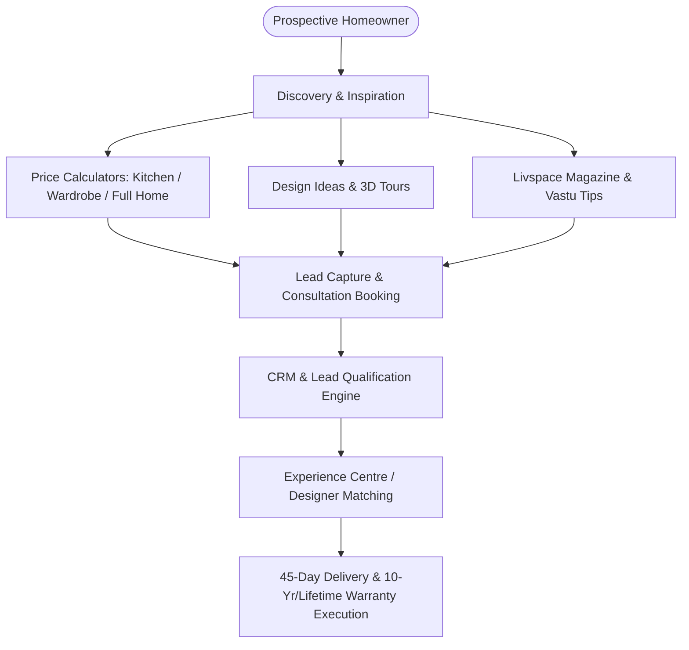

# Architectural & Feature Analysis Report: Livspace (India)
**Target Platform:** [livspace.com/in](https://www.livspace.com/in)  
**Analysis Date:** October 2026  
**Subject:** High-Level Architecture, Frontend System, Core Product Features, Conversion Funnels & Engineering Breakdown

---

## 1. Executive Summary

**Livspace** is India's premier end-to-end interior design and renovation platform connecting homeowners with interior designers, verified vendors, and modular furniture manufacturing. The web application is engineered as a high-traffic, SEO-first, content-rich lead conversion engine tailored to convert browsing intent into booked design consultations and estimator leads.

---

## 2. Technology Stack & Platform Architecture

| Layer | Technologies / Implementations | Key Details & Observations |
| :--- | :--- | :--- |
| **Frontend Framework** | **Nuxt.js (Vue.js SSR)** | Built using Nuxt Server-Side Rendering (`data-n-head-ssr`, Nuxt layout system) for instant First Contentful Paint and search engine indexing. |
| **Styling & Design System** | Custom Utility Classes + Scoped CSS | Scoped attribute styling (`data-v-*`), atomic utility classes (`flex`, `items-center`, `top-0`, `sticky`), and dedicated brand CSS variables. |
| **Typography & Fonts** | Google Fonts / Webfonts | Primary font families: **Poppins** (Weights: 100, 400, 500, 600, 700) and **Roboto** + Material Icons Outlined. |
| **Image Pipeline & CDN** | Custom CDN (`images.livspace-cdn.com`) | Dynamic resizing (`/w:1440/plain/...`), Next-Gen **AVIF** and **WebP** formats with responsive `srcset` and `sizes` attributes for responsive mobile/desktop delivery. |
| **Slider / Carousel** | **Swiper.js** | Used across hero banners, price calculator cards, customer video testimonials, and category carousels. |
| **Analytics & Tracking** | RudderStack, Google Tag Manager, Engati, Bikayi | Multi-channel user telemetry, CRM attribution tracking, and live conversational chatbots. |
| **Structured Data / SEO** | JSON-LD Schemas | Comprehensive Organization schema, WebSite search action, FAQPage schema, and hreflang tags (`en-in`, `en-sa`). |

---

## 3. Core Functional Modules & Feature Breakdown

### A. Dynamic Price Estimators & Calculators
Livspace utilizes modular calculation tools as high-converting interactive hooks:
1. **Full Home Interior Price Calculator**: Configures cost based on apartment configuration (1 BHK, 2 BHK, 3 BHK, 4 BHK+ / Villa), scope (modular only vs full home), and finish tiers.
2. **Modular Kitchen Price Estimator**: Breaks down layout types (L-shaped, U-shaped, Parallel, Straight, Island), core materials (MDF, Commercial Ply, BWR/BWP), and hardware tiers (Hettich, Blum).
3. **Wardrobe Price Estimator**: Calculates based on dimensions, swing vs sliding doors, and internal carcass configurations.

### B. "Design Ideas" & Visual Catalogue
- Categorized by functional spaces: Modular Kitchens, Master Bedrooms, Living Rooms, Pooja Rooms, Balconies, TV Units, False Ceilings, Foyers, and Space-Saving Solutions.
- Deep filtering by design aesthetics (Modern, Bohemian, Scandinavian, Industrial, Indian Contemporary, Minimalist, Art Deco).

### C. Omnichannel Lead Gen & Consultation Booking
- **Primary CTA**: "Book Free Consultation" persistent across hero sections, sticky headers, and bottom mobile app bars.
- **Experience Centre Locator**: Deep directory covering 50+ tier-1 & tier-2 Indian cities (Bengaluru, Mumbai, Delhi-NCR, Hyderabad, Chennai, Pune, Kolkata, Ahmedabad, etc.).
- **Consultation Flow**: Multi-step modal capturing floor plan status, property city, possession timeline, and contact verification.

### D. Social Proof & Trust Architecture
- **45-Day Move-in Guarantee**: Modular interior installation guarantee.
- **Warranty Badging**: 10-Year to Lifetime warranty on modular woodwork.
- **Video Testimonials & Case Studies**: Customer video interviews with real floor plans and quotes.

### E. Content Marketing & Magazine
- In-depth articles covering design trends, Vastu Shastra rules, materials guides, renovation tips, and real home walkthroughs.

---

## 4. UI / UX Design System Insights

- **Color Palette**: Clean white base with vibrant primary accent colors (Livspace Crimson/Ruby Red `#ED2939` / `#D8232A`), neutral slate grays, and soft warm off-whites.
- **Interactive Micro-Interactions**: Hover elevation on cards, 3D rotating text badges for offerings, sliding drawer navigation on mobile, and smooth Swiper touch sliders.

---

## 5. Potential Engineering & Modernization Opportunities

If developing a modern competitor, clone, or interior design web app inspired by Livspace:

1. **Modern Frontend Stack**: Vite + React / Next.js 15 or Vue 3 + Nuxt 3 with TypeScript and Tailwind CSS.
2. **3D Interactive Room Planner**: Integrate Three.js / WebGL / Canvas allowing users to drag-and-drop modular cabinets and customize textures in real time.
3. **Instant AI Design Generator**: Allow clients to upload a photo of an empty room and generate rendered concepts using AI.
4. **Real-time Dynamic Quotation Engine**: Step-by-step interactive stepper giving live price updates as users adjust materials and layouts.
5. **Client Portal & Project Milestone Tracker**: A dashboard tracking 45-day milestones: Design Approval → Factory Production → Dispatch → Installation → Handover.
